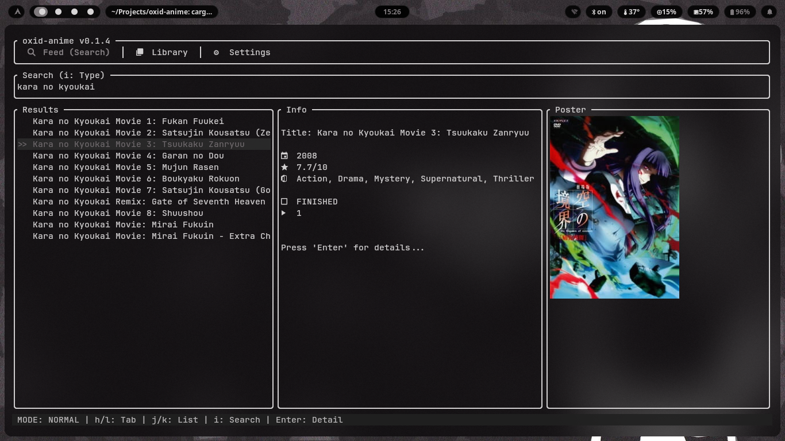

# oxid-anime

A TUI anime watching app built with Rust.

## Project Status

**Early Access (v0.2.0)** – Core UI, search, and local library are functional.

**Currently working on:**

- MPV integration
- TypeScript/JavaScript plugin system
- AniList sync (import/export library)

## Features

- Fast TUI with Kitty/Ghostty image support
- Hybrid search (offline DB + AniList API)
- Local-first library: track watch status, progress, and scores
- English & Turkish localization

> Note: Developed with AI assistance, human-managed architecture.

## Data License

This application uses anime metadata from the
[anime-offline-database](https://github.com/cedya77/anime-offline-database)
project, which continues the original
[manami-project/anime-offline-database](https://github.com/manami-project/anime-offline-database).

The data is licensed under the Open Database License (ODbL) v1.0, with
individual contents under the Database Contents License (DbCL) v1.0. See the
`LICENSE-DATA` file for details.
