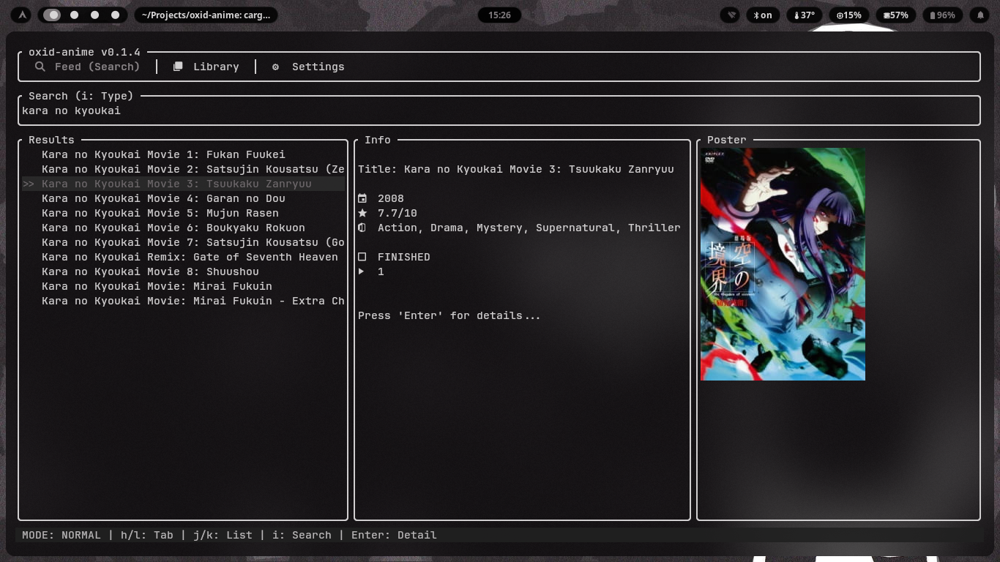

# oxid-anime

A TUI anime library and tracking app built with Rust.



## Installation

### From source (requires Rust)

```bash
cargo install --git https://github.com/thetricyrtis/oxid-anime --tag v0.3.0
```

## Project Status

**v0.3.0 (alpha)** – Core UI, search, and local library are functional.

**To Do:**

- MPV integration
- TypeScript/JavaScript plugin system
- AniList sync (import/export library)

## Features

- Fast TUI with Kitty/Ghostty image support
- Hybrid search (offline DB + AniList API)
- Local-first library: track watch status and progress
- English & Turkish localization

## Data Locations

On Linux, oxid-anime stores its data in:

- Database: `~/.local/share/oxid-anime/database/oxid.db`
- Cache: `~/.cache/oxid-anime/`

> Note: Developed with AI-assisted code, human-designed architecture and
> testing.

## Data License

This application uses anime metadata from the
[anime-offline-database](https://github.com/cedya77/anime-offline-database)
project, which continues the original
[manami-project/anime-offline-database](https://github.com/manami-project/anime-offline-database).

The data is licensed under the Open Database License (ODbL) v1.0, with
individual contents under the Database Contents License (DbCL) v1.0. See the
`LICENSE-DATA` file for details.
